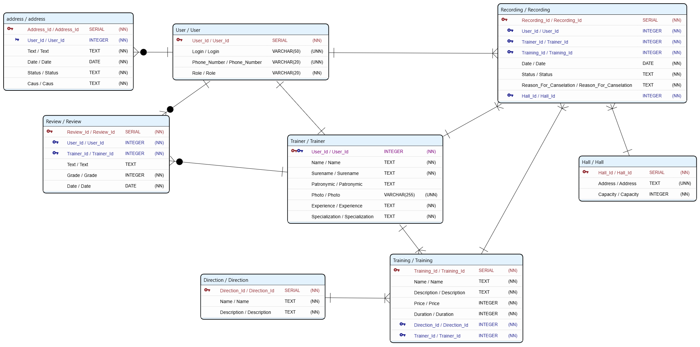

## Предметная область
Приложение для тренажерного зала. Роли пользователей: клиент, тренер, администратор.

## ER-диаграмма
Схема базы данных, спроектированная в ERD Designer:

## Пользователь:
- скачать приложение / открыть в браузере
- зарегистрироваться / авторизоваться (или анонимный просмотр)
- просмотреть список тренировок / тренеров / направлений
- поиск / фильтрация (направление, тренер, время, уровень)
- просмотреть карточку тренера (фото, описание, опыт, отзывы) и карточку тренировки
- записаться на тренировку
- удалить/отменить запись
- начать оформление записи (переход на регистрацию/авторизацию)
- настроить способ оплаты (привязка карты / абонемент)
- подтвердить запись / покупку абонемента
- смотреть свои записи и историю
- оставить отзыв о тренере
- обратиться в поддержку

## Тренер:
- регистрация / создание профиля тренера
- создать тренировку (слот)
- смотрит список своих тренировок
- удалять тренировку
- смотреть статистику (клиенты, посещаемость, отзывы)
- посмотреть активные записи
- отметить посещение / отменить тренировку
- обратиться в поддержку
- Техподдержка / Админ:
- войти в свой кабинет
- просмотреть список обращений
- открыть обращение
- решить вопрос и закрыть обращение

## системный аналитик
- Пользователь — role (client, trainer, admin), номер телефона / почта, пароль (хеш!) 
- Тренер — профиль: ФИО, фото, описание, опыт, специализация, id пользователя
- Зал — адрес, id, площадь, вместимость
- Тренировка — картинка, описание, цена/стоимость, длительность, направление, тренер, зал, отзывы
- Направление / категория — название, описание (для фильтрации)
- Запись — клиент, тренировка, тренер, зал, время, способ оплаты, статус (активна / отменена / посещена)
- Обращение — отправитель, текст, картинки, причина, категория
- Отзыв — автор, тренер/тренировка, текст, оценка, картинки

## Требования
- Пароль не хранить в открытом виде.
- Авторизация и регистрация для всех 3 ролей.
- Разграничение прав по ролям (клиент, тренер, админ).
- Хранение паролей в виде хеша.
- Возможность записи на тренировки и отмены записей.